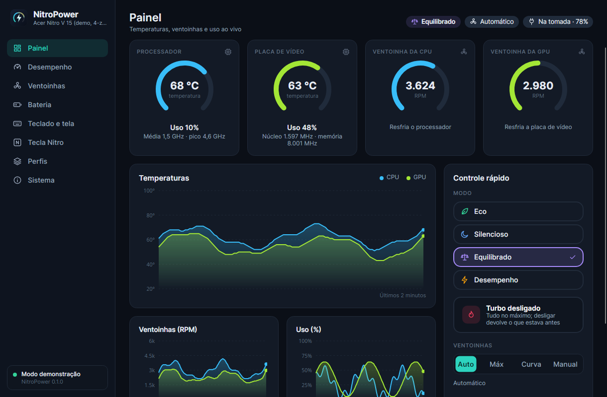

# NitroPower

Central de controle para notebooks Acer Nitro no Linux: modos de desempenho,
overclock da GPU, ventoinhas, bateria, teclado, tela e botão Nitro, em um
único pacote.

Não é afiliado à Acer. "Nitro" e "NitroSense" são marcas da Acer Inc.



## Interface

`nitropower` (ou NitroPower no menu de aplicativos) abre a janela. Ela fala com
o `nitropowerd`, então não pede senha.

| Página | O que faz |
|---|---|
| Painel | Temperaturas, ventoinhas, uso e frequência de CPU e GPU ao vivo, com gráficos dos últimos 2 minutos; troca de modo, turbo e ventoinhas com um clique |
| Desempenho | Modos de operação, turbo (o que liga e para onde volta), ciclo da tecla de modo, overclock da GPU com níveis editáveis por modo |
| Ventoinhas | Automático, máximo, velocidade fixa ou curva própria, com editor gráfico (arrastar, adicionar, remover pontos) e modelos prontos |
| Bateria | Carga, potência, tempo restante, saúde e ciclos; limite de 80%, calibração e carga USB com o notebook desligado |
| Teclado e tela | Luz do teclado, overdrive da tela, som ao ligar e teclado RGB de 4 zonas (efeitos e cor por zona, com prévia) |
| Tecla Nitro | Turbo, trocar modo, abrir o NitroPower ou nada; teste da tecla |
| Perfis | Salvar e aplicar conjuntos de ajustes |
| Sistema | Modelo, BIOS, drivers, parâmetros do `linuwu_sense`, registros do serviço; idioma, tema, bandeja e início com a sessão |

Também tem ícone na bandeja (modos, turbo e ventoinhas), português e inglês,
tema escuro e claro. `nitropower --demo` mostra a interface com hardware de
mentira. Mais capturas em [`docs/screenshots/`](docs/screenshots/).

## Instalação (desenvolvimento)

```bash
packaging/build.sh                              # como usuário: testes + publicação em artifacts/
sudo packaging/install-dev.sh --replace-damx    # daemon, CLI, interface, avisos na sessão
sudo packaging/install-dev.sh remove
```

O instalador desativa o `nitro-gpu-oc` e o atalho do GNOME da tecla Nitro, que
o `nitropowerd` substitui, e devolve os dois no `remove`. Com `--replace-damx`
ele também desliga o daemon do DAMX e esconde o atalho dele. Depois de
instalar, saia e entre na sessão uma vez para entrar no grupo `nitropower`
(interface e CLI sem sudo).

## Linha de comando

```bash
nitropower-cli status                 # tudo de uma vez (sem root)
nitropower-cli mode performance       # eco | quiet | balanced | performance
nitropower-cli turbo toggle           # modo máximo + ventoinhas no máximo
nitropower-cli nitro-key cycle        # tecla Nitro: turbo | cycle | gui | none
nitropower-cli fan 60 70              # ventoinhas CPU/GPU em %; auto | max
nitropower-cli fan curve set cpu 45:25,60:40,75:65,88:100
nitropower-cli gpu-oc levels 0/0 0/0 100/200   # overclock por nível (núcleo/memória)
nitropower-cli battery-limit on       # carga até 80%
nitropower-cli keyboard effect wave --speed 5 --direction ltr
nitropower-cli preset save jogo       # e depois: preset load jogo
nitropower-cli watch --notify         # avisos de modo, turbo e tecla Nitro
```

Com o `nitropowerd` rodando, quem está no grupo `nitropower` não precisa de
sudo. Sem o daemon, os comandos agem direto no hardware e alterações pedem sudo.
`nitropower-cli help` lista todos os comandos.

## Documentação

- [Linuwu-Sense no NitroPower](docs/LINUWU-SENSE.md)
- [Atualizar a BIOS pelo Linux](docs/BIOS.md)
- [API do nitropowerd](docs/API.md)
- [Arquitetura e roteiro](docs/ARQUITETURA.md)
- Modelos suportados: veja [`profiles/`](profiles/)

Licença: GPL-3.0-or-later. O driver em `driver/` é GPL-2.0-or-later.
