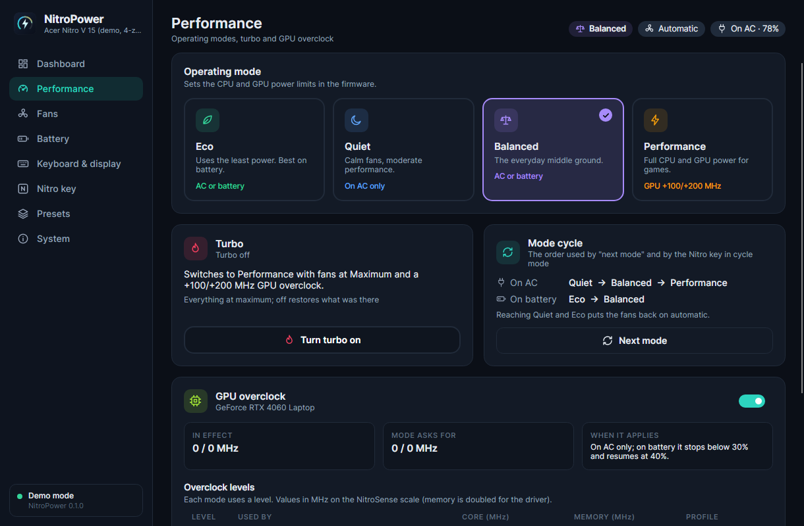
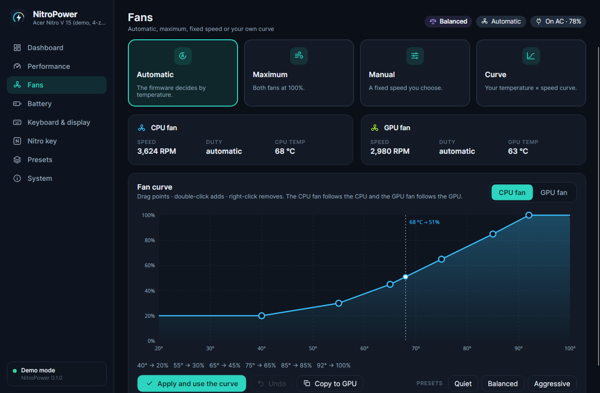

# NitroPower

Control center for Acer Nitro laptops on Linux: performance modes, GPU
overclock, fans, battery, keyboard, display and the Nitro key, in a single
package.

Not affiliated with Acer. "Nitro" and "NitroSense" are trademarks of Acer Inc.


## Interface

`nitropower` (or NitroPower in the application menu) opens the window. It talks
to `nitropowerd`, so it does not ask for a password.

| Page | What it does |
| --- | --- |
| Dashboard | Live temperatures, fan speeds, CPU and GPU load and clocks, with charts of the last 2 minutes; one-click mode, turbo and fan control |
| Performance | Operating modes, turbo (what it turns on and what it restores), mode key cycle, GPU overclock with editable levels per mode |
| Fans | Automatic, maximum, fixed speed or a custom curve, with a graphical editor (drag, add and remove points) and ready-made templates |
| Battery | Charge, power draw, time remaining, health and cycles; 80% charge limit, calibration and USB charging while powered off |
| Keyboard & display | Keyboard backlight, display overdrive, boot sound and 4-zone RGB keyboard (effects and per-zone color, with a preview) |
| Nitro key | Turbo, cycle modes, open NitroPower or nothing; key test |
| Presets | Save and apply sets of settings |
| System | Model, BIOS, drivers, `linuwu_sense` parameters, service logs; language, theme, tray and start with the session |

It also has a tray icon (modes, turbo and fans), English and Brazilian
Portuguese, and dark and light themes. `nitropower --demo` shows the interface
with simulated hardware. More screenshots in
[`docs/screenshots/`](docs/screenshots/).

| Performance | Fans |
| --- | --- |
|  |  |

## Installation (development)

```bash
packaging/build.sh                              # as your user: tests + publish to artifacts/
sudo packaging/install-dev.sh --replace-damx    # daemon, CLI, interface, session notifications
sudo packaging/install-dev.sh remove
```

The installer disables `nitro-gpu-oc` and the GNOME shortcut for the Nitro key,
which `nitropowerd` replaces, and restores both on `remove`. With
`--replace-damx` it also stops the DAMX daemon and hides its launcher. After
installing, log out and back in once to join the `nitropower` group (interface
and CLI without sudo).

## Command line

```bash
nitropower-cli status                 # everything at once (no root)
nitropower-cli mode performance       # eco | quiet | balanced | performance
nitropower-cli turbo toggle           # top mode + fans at maximum
nitropower-cli nitro-key cycle        # Nitro key: turbo | cycle | gui | none
nitropower-cli fan 60 70              # CPU/GPU fans in %; auto | max
nitropower-cli fan curve set cpu 45:25,60:40,75:65,88:100
nitropower-cli gpu-oc levels 0/0 0/0 100/200   # overclock per level (core/memory)
nitropower-cli battery-limit on       # charge up to 80%
nitropower-cli keyboard effect wave --speed 5 --direction ltr
nitropower-cli preset save gaming     # then: preset load gaming
nitropower-cli watch --notify         # notifications for mode, turbo and the Nitro key
```

While `nitropowerd` is running, members of the `nitropower` group do not need
sudo. Without the daemon, commands act on the hardware directly and changes
require sudo. `nitropower-cli help` lists every command.

## Documentation

- [Linuwu-Sense in NitroPower](docs/LINUWU-SENSE.md)
- [Updating the BIOS from Linux](docs/BIOS.md)
- [nitropowerd API](docs/API.md)
- [Architecture and roadmap](docs/ARCHITECTURE.md)
- [Changelog](CHANGELOG.md)
- Supported models: see [`profiles/`](profiles/)

License: GPL-3.0-or-later. The driver in `driver/` is GPL-2.0-or-later.
